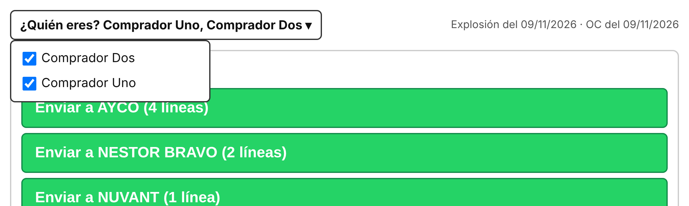
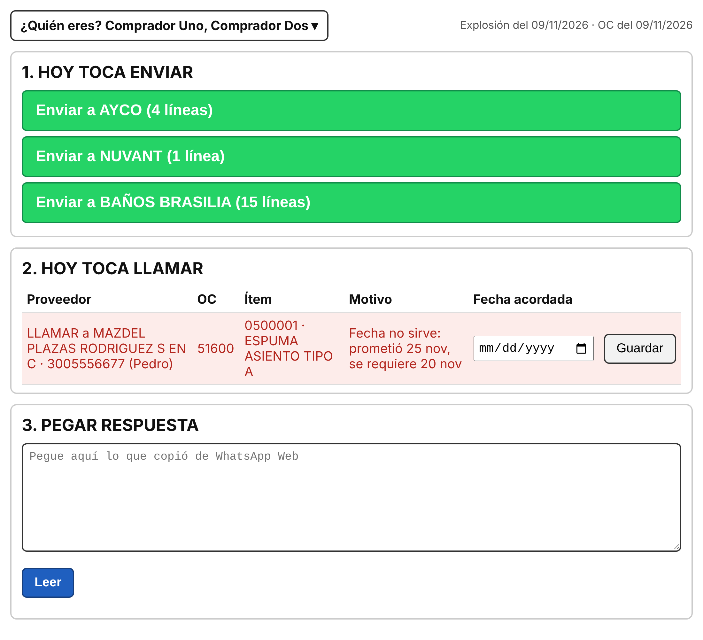
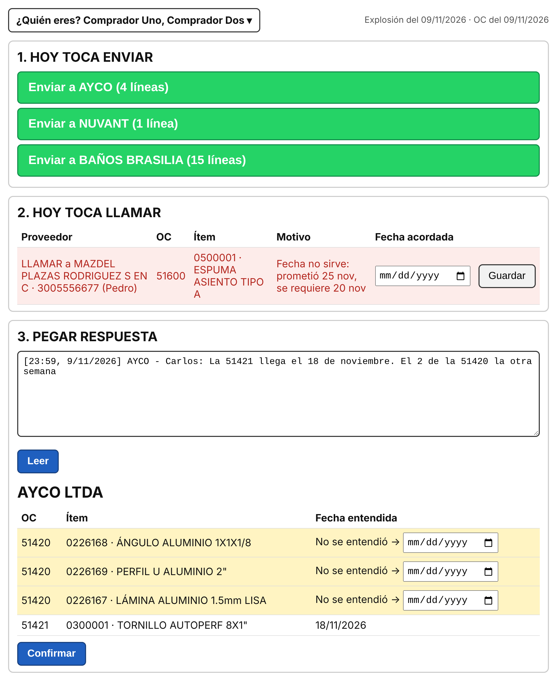

# Seguimiento a proveedores — Guía del COMPRADOR

Abra el archivo **`index.html`** con **Edge o Chrome** (doble clic). La primera vez el navegador le pide la carpeta: elija **CARPETA_RAIZ** y acepte "Permitir editar". Después la recuerda; si vuelve a preguntar, oprima **"Abrir la carpeta de seguimiento"** y acepte.

Tenga abierto **WhatsApp Web** en el mismo navegador.

## Paso 1 — Diga quién es

Arriba, en **"¿Quién eres?"**, marque su nombre. Puede marcar varios (por ejemplo, si cubre a un compañero en vacaciones). Se queda guardado.

## Paso 2 — Envíe y llame

**1. HOY TOCA ENVIAR:** oprima cada botón verde. Se abre WhatsApp con el mensaje ya escrito: solo oprima **Enviar** en WhatsApp. La herramienta decide a quién y qué preguntar; usted no escoge nada.

**2. HOY TOCA LLAMAR (rojo):** llame a ese proveedor. Cuando acuerde la fecha, escríbala en **"Fecha acordada"** y oprima **Guardar**.
- *Sin respuesta*: no contestó dos WhatsApp.
- *Fecha no sirve*: prometió una fecha posterior a la que necesitamos.

## Paso 3 — Pegue la respuesta del proveedor

1. En WhatsApp Web, seleccione los mensajes de respuesta del proveedor (pase el mouse por el mensaje → flecha → **Seleccionar mensajes**), y cópielos con **Ctrl+C**. Así se copian con el encabezado `[hora, fecha] Nombre:` que la herramienta necesita.
2. Péguelos en **"3. PEGAR RESPUESTA"** y oprima **Leer**.
3. Revise la tabla: sale el nombre del proveedor en grande y, por cada línea, la fecha que se entendió.
   - Filas **amarillas** = no se entendió (ej. "la otra semana"). Escriba usted la fecha. Si la deja vacía, esa línea no se cambia.
4. Oprima **Confirmar**. Se guarda solo.

## Mensajes que puede ver

| Aviso | Qué hacer |
|---|---|
| Rojo **BLOQUEADO: la OC … no es de …** | El proveedor mencionó una OC que no es suya. Aclárelo con él; no se guarda nada. |
| Rojo **Remitente desconocido** / **No se ve el encabezado** | Copie los mensajes como dice el paso 3. Si el nombre del contacto cambió, avise al jefe de compras. |
| Rojo **NO SE GUARDÓ** | Alguien tiene abierto `fechas_prometidas.xlsx`. Pida que lo cierre y repita. |
| Amarillo **Se está usando la explosión del …** | Puede trabajar normal. Avise al analista. |

No hay nada que exportar: todo queda en `registro\fechas_prometidas.xlsx`.
